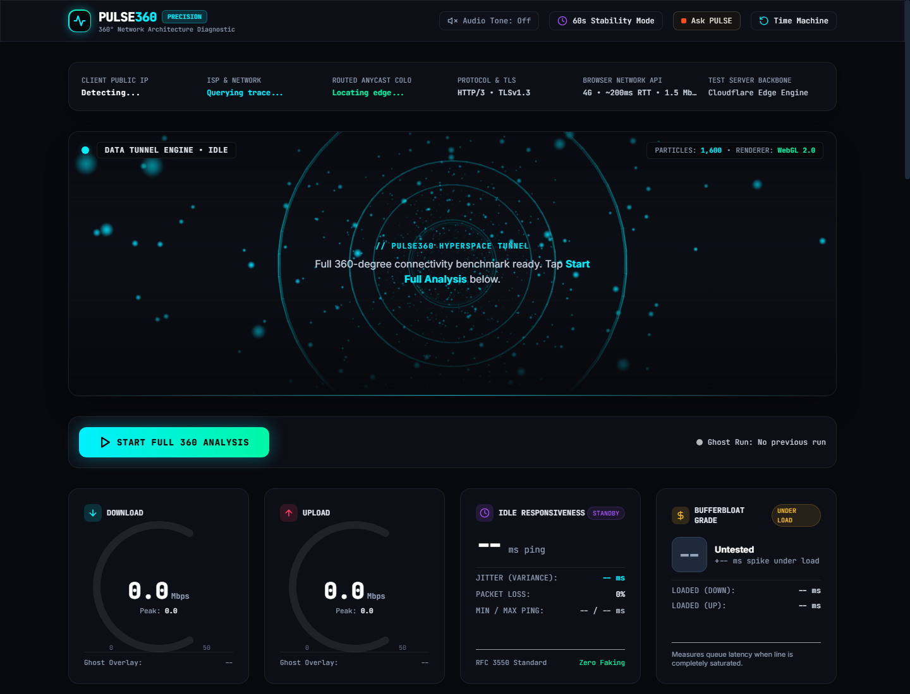

# PULSE360 — 360° Network Architecture Diagnostic & Grounded AI Operator

> **PULSE360** analyzes internet connectivity from every angle: download/upload throughput, idle latency & jitter, bufferbloat grading under saturation, DNS resolver benchmarks, 60s stability variance, and real-life workload verdicts. Includes **Ask PULSE**, a grounded AI diagnostic operator with typo tolerance and interactive action dispatching.



---

## ⚡ Key Highlights

- **Real-Time 360° Telemetry**: Streaming download & upload measurements (~100ms UI refresh) using Cloudflare Anycast edge endpoints. Zero mock data.
- **Bufferbloat & SQM Audit**: Active loaded latency benchmark measuring queue delay under bidirectional network saturation (RFC 3550 standard).
- **Network DNA Fingerprint**: Composite radar score evaluating speed, stability, latency, upload, bufferbloat, and DNS with exportable canvas report card.
- **Interactive WebGL Data Tunnel**: Hyperspace particle tunnel driven live by network throughput.
- **60-Second Stability Mode**: Continuous high-frequency ping and throughput sampling charting standard deviation and jitter variance.
- **Ask PULSE (AI Operator)**:
  - Bottom-right corner AI assistant popup.
  - **Typo Tolerance & Fuzzy Matching**: Uses Damerau-Levenshtein distance to recognize misspelled queries (e.g. `donwload`, `dwonload`, `uplaod`, `pnig`, `buffrblot`, `stablty`).
  - **Action Dispatch Protocol**: Can trigger tests on demand (e.g. `test my speed`, `run stability`, `export dna`).
  - **Laser-Focused Answers**: Displays results first, cleanly formatted with clickable follow-up suggestions and zero distracting source clutter.
  - **Generic Fallback**: Handles out-of-scope or unrecognized questions with a conversational ChatGPT/Gemini-style operator response.

---

## 🚀 Getting Started

### Prerequisites

- [Node.js 22+](https://nodejs.org/) (native runtime with zero external production dependencies).

### Running Locally

1. **Clone the repository**:
   ```bash
   git clone https://github.com/soumyab92/pulse360.git
   cd pulse360
   ```

2. **Start the server**:
   ```bash
   node server.js
   ```

3. **Open the application**:
   Open [http://localhost:3000](http://localhost:3000) in your web browser.

---

## 🐳 Docker Deployment

The application is fully containerized with minimal alpine footprint (<180MB):

```bash
# Build the container
docker build -t pulse360 .

# Run the container
docker run -p 3000:3000 pulse360
```

---

## ▲ Deploying to Vercel

PULSE360 is optimized for zero-config deployment on [Vercel](https://vercel.com/):

1. Go to **[vercel.com/new](https://vercel.com/new)**.
2. Select your imported GitHub repository: **`soumyab92/pulse360`**.
3. Leave all default build settings as detected (Framework: **Other**, Root Directory: `./`).
4. Click **Deploy**.
5. Your PULSE360 instance is immediately live worldwide with global Edge CDN caching and serverless API execution!

---

## 📡 API Endpoints

- `GET /health` or `GET /api/health`: Health check and uptime probe.
- `GET /api/knowledge`: Returns chunked knowledge base files.
- `POST /api/pulse-llm`: Streaming SSE endpoint for Ask PULSE reasoning and action dispatching.

---

## 📜 License

MIT License. Designed and engineered for high-precision network diagnostics.

